<!-- Night Signal Box: #0A0E14 navy · #2DD4A6 teal · #E8A94C amber -->

  

  
  
  

  
  
  
  

 

## 👨‍💻 About Me

- 🎓 Pursuing **B.Tech in Computer Science & Engineering** at Lovely Professional University, 5th Semester
- 💻 Solo **full-stack developer**, building projects and hackathon submissions end to end
- ☁️ Focused on **Cloud Computing**, exploring AWS architecture, infrastructure and services
- 🐳 Actively learning **Docker** and containerized deployments
- 🤖 Into **AI-integrated applications**, building with Gemini, Groq and RAG pipelines
- 🌱 A **self-driven learner**, always picking up something new and building on it
- 🤝 Looking to **collaborate**, contribute to projects and grow with great people

 

---

## 🛠️ Tech Stack

Strongest in full-stack development, with cloud and DevOps alongside it

 

<table align="center">
<tr>
<td align="right" valign="middle" width="190"><b>Languages</b> what I code in</td>
<td valign="middle"></td>
</tr>
<tr>
<td align="right" valign="middle" width="190"><b>Frontend</b> what users see</td>
<td valign="middle"></td>
</tr>
<tr>
<td align="right" valign="middle" width="190"><b>Backend</b> APIs and services</td>
<td valign="middle"></td>
</tr>
<tr>
<td align="right" valign="middle" width="190"><b>Database</b> where data lives</td>
<td valign="middle"></td>
</tr>
<tr>
<td align="right" valign="middle" width="190"><b>Cloud &amp; DevOps</b> how it ships</td>
<td valign="middle"></td>
</tr>
<tr>
<td align="right" valign="middle" width="190"><b>Mobile</b> apps on the phone</td>
<td valign="middle"></td>
</tr>
<tr>
<td align="right" valign="middle" width="190"><b>Tools</b> daily workflow</td>
<td valign="middle"></td>
</tr>
<tr>
<td align="right" valign="middle" width="190"><b>AI &amp; APIs</b> smart features</td>
<td valign="middle">

</td>
</tr>
<tr>
<td align="right" valign="middle" width="190"><b>CS Fundamentals</b> the base</td>
<td valign="middle">

</td>
</tr>
</table>

---

## 🚀 Currently Learning

| Topic | Status |
|:---|:---|
| ☁️ AWS & Cloud Infra | Actively exploring EC2, S3, IAM, Terraform |
| 🐳 Docker | Building fundamentals, containerizing projects |
| ⚡ Data Structures & Algorithms | Solving problems daily |
| ☕ Spring Boot | Building fundamentals |

---

## 📊 GitHub Stats

 

  

<picture>
  <source media="(prefers-color-scheme: dark)" srcset="https://raw.githubusercontent.com/Vishal0247/Vishal0247/output/github-snake-dark.svg" />
  <source media="(prefers-color-scheme: light)" srcset="https://raw.githubusercontent.com/Vishal0247/Vishal0247/output/github-snake.svg" />
  
</picture>

---

## 📫 Let's Connect

Got a project idea, want to collaborate, or just want to say hi? I'm always up for a good conversation.

  
  
  
  

<em>Thanks for stopping by! ⭐ If you find any of my work useful, feel free to star a repo.</em>

